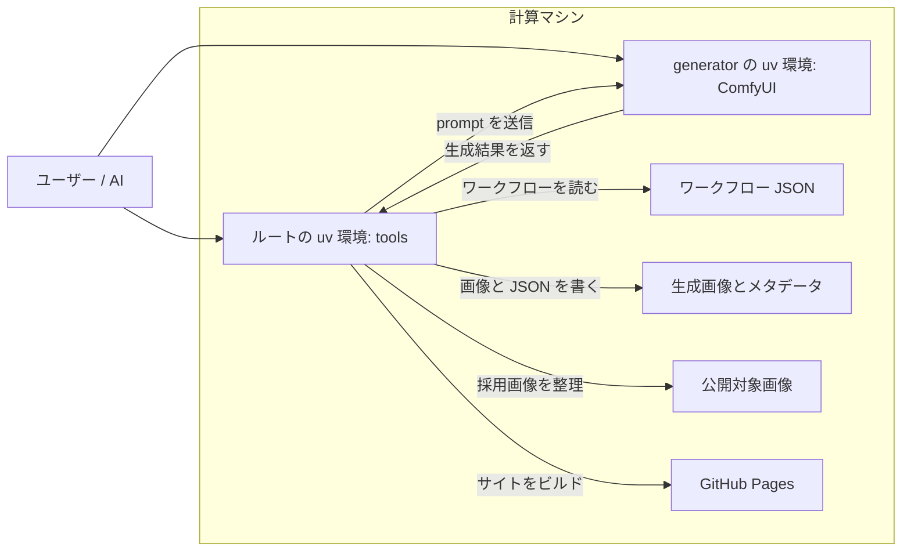

# cigar-box-design-lab

シガーボックスジャグリングの道具（広い面 180x120mm / 165x120mm）に貼る**デコレーションデザインを、AI で発散的に探索するための個人用ラボ**です。

従来は壁紙シートを手で細かく切って作ることが多かったデザインを、コンビニのシール紙プリントで代替できないか、という検討が出発点です。デザインを考える部分は AI に任せ、人間は「好き / 嫌い / 保留」を付けることに集中します。

## 位置づけ

- 個人用のモノレポです。広く使ってもらうことは想定していません。
- 興味を持ってくれた友人が **fork して画像データを差し替えれば、自分用にチューニングできる**状態を目指します。そのため、各ディレクトリの役割と手順の説明は厚めに書きます。
- 発散で得たデザインの**微調整**は、別ツールの [cigar-box-design-simulator](https://oyuno-hito.github.io/cigar-box-design-simulator/draft/) が担当します。このリポジトリは、その手前の「発散的にデザイン案を得る」部分を扱います。

## ディレクトリ構成

| パス | 役割 | Git 管理 |
| --- | --- | --- |
| `.cursor/` | AI 向けの資料（rules、skills） | する |
| `docs/` | ワークフロー、設計判断 | する |
| `generator/` | uv で管理する ComfyUI、ワークフロー、モデル備忘録 | モデル本体は除く |
| `generated/` | 生成画像の正本。`0_like`（`reference` / `seed`）/ `1_dislike` / `2_maybe` / `99_inbox` に分類 | する |
| `runs/` | 実験 run（題材ごとの生成・採点・レビューの記録）。テキストと一覧画像（`contact.webp`）だけ管理し、PNG は管理しない（見本 2 件のみ例外）。[runs/README.md](runs/README.md) | 一部 |
| `scorers/` | 分類器（スコアラー）。係数・マニフェスト・評価結果の JSON。版は Git の履歴で管理 | する |
| `artifacts/` | 最終採用した成果物のコレクション | する |
| `site/` | GitHub Pages 用の HTML / JS。公開するのは `artifacts/` のみ | する |

## 基本の流れ

1. 発散的に画像を生成する（LLM の画像生成でシートを作って切り出す方式、またはローカルの ComfyUI）。手順は `.cursor/skills/generate-test-images/`。
2. `generated/99_inbox/` に入れ、人間が `like` / `dislike` / `maybe` に振り分ける。判断の基準は「この画像から手直しの方向を見出せるか」（[generated/README.md](generated/README.md)）。
3. 分類器を作る。作った時点で参照した画像は `scorers/manifest.json` に固定する。
4. 分類器で足切り・並べ替えし、残りを VLM で再評価する。
5. 採用したものを `artifacts/` に置き、GitHub Pages で公開する。

詳細は [docs/workflow.md](docs/workflow.md) にあります。

## 開発環境（Python は uv に一本化）

`tools/` のスクリプトは、[uv](https://docs.astral.sh/uv/) で管理する Python 3.12 の環境で動かします。システムの Python や `pip` は使いません。Python のバージョンと依存のバージョンは、`.python-version`、`pyproject.toml`、`uv.lock`（すべて Git 管理）で固定しています。

```bash
brew install uv      # 初回だけ（macOS。他の OS は uv の公式手順）
uv sync              # .venv を作る（torch を含むので初回は数 GB）
uv run tools/build_site.py --serve
```

- スクリプトは、`.venv` を有効化せずに `uv run tools/<スクリプト>.py` で動かす。`uv run` は、ロックと環境がずれていれば自動で同期する。標準ライブラリだけのスクリプトも、同じ Python で動くよう `uv run` で呼ぶ。
- 依存を足すとき: `uv add <パッケージ>`（分類器用は `uv add --group scorer <パッケージ>`）。`pyproject.toml` と `uv.lock` が更新されるので、両方コミットする。
- 分類器（torch など）が要らないときは `uv sync --no-group scorer` で軽くできる。
- GitHub Pages の CI（`.github/workflows/pages.yml`）は、標準ライブラリだけの `build_site.py` を `setup-python`（3.12）で動かす。uv は使わない。
- ComfyUI は、この環境とは別に動かす（[generator/README.md](generator/README.md)）。`tools/run_generate.py` は HTTP API だけを使う。

### システム構成

uv は共通の管理方式だが、依存関係の衝突を避けるため仮想環境は用途ごとに分けている。現在の Mac では Apple Silicon の MPS を計算デバイスに使う。



`tools/` はルートの `.venv`（Python 3.12）で `uv run tools/<スクリプト>.py` として実行する。標準ライブラリだけのスクリプトも、実行環境を揃えるため同じ方法で呼ぶ。ComfyUI 本体は `generator/.venv` で動き、`tools/run_generate.py` とは HTTP API 経由で接続する。

## Git フック（clone 後に 1 回）

push 前に `generated/` の整合性を確認します。clone したら、次を 1 回実行してください。

```bash
git config core.hooksPath .githooks
```

[tools/check_generated.py](tools/check_generated.py) を呼びます。正常なときは何も表示しません。

- `pre-commit`: 画像と同名の `.json` が、同じディレクトリに 1 組ずつ揃っていないとエラー（仕分けで片方だけ移動した場合など）
- `pre-push`: 上に加えて、`generated/99_inbox/` に未分類の画像・JSON が残っているとエラー

意図して未分類のまま push するときだけ、`ALLOW_INBOX=1 git push` で inbox の確認を省略できます（常用しない）。

## 公開範囲についての注意

GitHub Pages に出すのは `artifacts/` だけです。`generated/`、`scorers/`、`generator/`、プロンプトやラベルは公開しません。リポジトリ自体を公開にする場合は、`generated/` の画像も公開になる点に注意してください。

## 状況

- 画像生成環境: ComfyUI v0.46.3 と依存を uv で管理する構成（[generator/README.md](generator/README.md)）。macOS の MPS で起動確認する。
- 画像の出力と仕分け: `tools/split_grid.py` とスキルで、24 枚ずつ `99_inbox` に出力し、手作業で仕分け中です。
- 分類器: 入っています（`scorers/`）。
- 公開サイト: 画像グリッドと拡大表示を `site/` に作りました（`uv run tools/build_site.py --serve` で確認）。`main` への push で GitHub Pages に出します（`.github/workflows/pages.yml`）。初回は Settings → Pages の Source を「GitHub Actions」にします。
